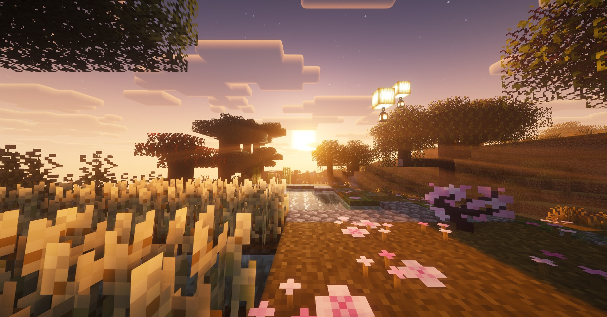
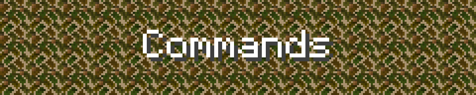
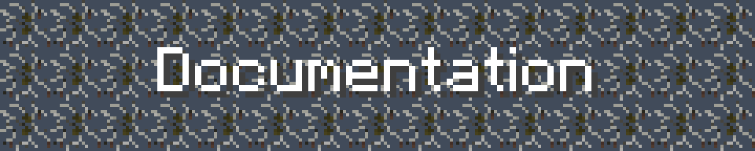

<p align="center"></p>

<h1 align="center">Equinox</h1>

<p align="center">
  
  
  <a href="LICENSE"></a>
  <a href="https://github.com/VenatorVictor/Equinox/wiki"></a>
</p>

<p align="center">The whole world follows the year: <b>Spring</b>, <b>Summer</b>, <b>Autumn</b> and <b>Winter</b>.</p>

| Spring | Summer |
|:---:|:---:|
|  |  |
| **Autumn** | **Winter** |
|  |  |

Equinox is a seasons mod for **NeoForge 1.21.1**. The seasons start on the equinoxes and solstices, with a
calendar, a moon that drifts through the months and long summer and short winter days; the world can even follow
the real date and clock. Every biome has its own °C year, snow falls and melts with the weather, crops grow by
temperature, and trees and plants live through the year: leaves turn and fall, cherries bloom, oaks grow acorns
you can pick and plant. No library mods are needed.


### Seasons
- Four seasons of 3 months each: 48 days on average (a 192-day year); 24, 72 or 96 (a 384-day year) in the settings. 12 months of
  equal length; weeks of 2 to 8 days, from the lengths that fit the month.
- As on Earth the seasons are uneven: spring and summer a little longer, starting on equinoxes and solstices on
  different days of the month (48-day seasons: March 10, June 11, September 12, December 11). The world starts on the
  spring equinox. A negative latitude is the south: the seasons swap months (spring from September).
- The day, the season and the colors turn at midnight. The year number turns on January 1.
- The moon's cycle is a little shorter than a month, as in real life, so the new moon moves through the months; its
  phase changes at noon, never in the night sky.
- Long summer days, short winter days, from the latitude.
- Every year is a bit different: random warmer or colder seasons and days.
- **Real time** (setting, off by default): the world follows the real clock and date. A day lasts 24 real hours,
  the seasons start at the real equinoxes and solstices of each year, the moon is the real one and the calendar shows
  real months and Monday-to-Sunday weeks. Beds only set the spawn point, `/time set` and `/season set` are blocked,
  and a time zone setting picks the clock.

### Calendar
- A calendar item: hang it on a wall (its season strip and month dots follow the date) or open its pages anywhere.
- Month page: the days by week, today framed, past days crossed out, the new and full moons, the equinoxes and
  solstices; click a day for its moon, day length and the next equinox or solstice. Arrows turn through the months.
- Moon page with the 8 phases and their days; events page with the year's equinoxes and solstices.
- Held, it shows the month, season, year and day at the top left.

### Climate
- Each biome has its own °C year: mild coasts, a cold north, deserts, rainy and dry tropics; the Nether and the End
  have their own temperatures.
- Neighbouring biomes blend, and winter fades out near jungles and deserts.
- Geothermal patches (hot ground and steaming pools from world generation) stay above freezing all winter.
- Other mods can read the air and water temperature through the API.

### Snow
- Snow appears during snowfall and melts in the rain.
- It settles in grass, flowers and plants, on fences, gates and walls, in a thin layer on stairs and slabs, and on
  leaves, with an animation as it appears and melts.
- Snow lies on crops too, and the snow cover is worked out a bit at a time within a time budget.
- Lakes and rivers freeze while it snows.

### Crops
- Crops grow by temperature: fast when it's ideal, slowly when it's cool or warm, dormant in the cold, killed by
  frost or heat.
- Campfires, torches and other heat sources protect them; ice cools them.
- On hot days farmland needs water closer by.

### Trees and plants
- Grass and leaves change color through the year; birches turn yellow and orange in autumn.
- Flowers bud, bloom and go to seed.
- Trees lose their leaves one by one in autumn and stand on bare twigs in winter; cherries bloom on the twigs in
  spring and flowering azaleas open their flowers in May.
- Oaks hang catkins in late spring. About a third of oak leaf blocks also get tiny red flowers that grow into
  acorns over the summer; pick the ripe acorns in mid autumn with a right click (they come back the next year).
  Planting an acorn grows an oak sapling.
- Birches keep small dark catkins on their bare twigs all winter; they open yellow at leaf-out. About a third of
  birch leaf blocks also hang seed catkins, green all summer and brown in autumn: pick them for birch seeds, which
  grow a birch sapling.
- Spruces stay green: red pollen cones open at the end of late spring, and about a third of spruce leaf blocks grow seed cones,
  red in spring, green over the summer and brown in early autumn: pick the ripe cones for spruce cones, which grow a
  spruce sapling. Old cones hang on through the winter.
- Snow lies on leaves too, in front of whatever they show (leaves, catkins, cones), wherever a snow layer covers them.


### More
- Distant Horizons: far terrain follows the colors and the snow.
- A config screen with tabs, descriptions and the performance cost of each setting.


1. Install [NeoForge](https://neoforged.net/) for Minecraft 1.21.1.
2. Put the Equinox jar in your `mods` folder, on both the server and the clients.

Equinox replaces other seasons mods; don't run it next to one.



| Command | Who | What it does |
|---|---|---|
| `/season` or `/season get` | everyone | Shows the season, the climate and the temperature where you stand |
| `/season set <season> [week]` | operators | Jumps to a season (or one of its weeks), keeping the time of day |
| `/season add <days>` | operators | Moves the year forward (or back) by some days |



See the [wiki](https://github.com/VenatorVictor/Equinox/wiki) for the seasons, the calendar, the climate, config options,
datapacks and the API.

## Building

```sh
./gradlew build
```

The jar ends up in `build/libs/`. Needs Java 21.

## License

Copyright (C) 2026 Victor Schramm

Equinox is free software under the [GNU General Public License v3.0](LICENSE): you can share and change it, and
anything you share that is built from it must be open source under the same licence.
