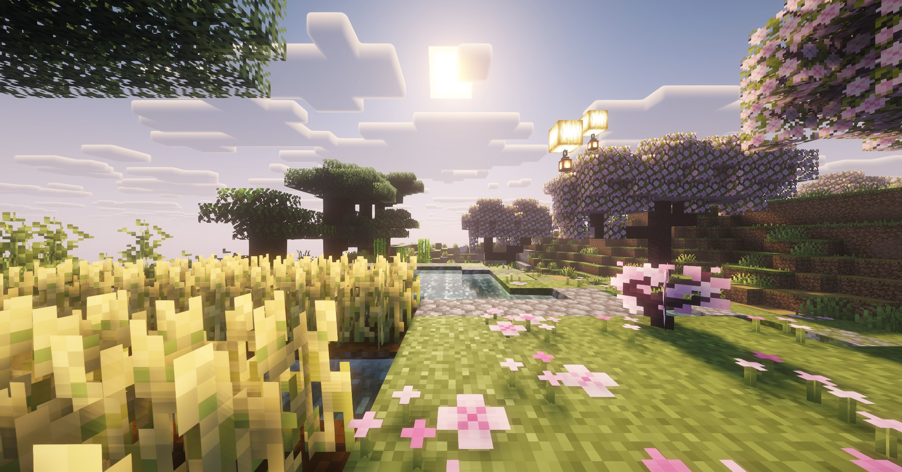
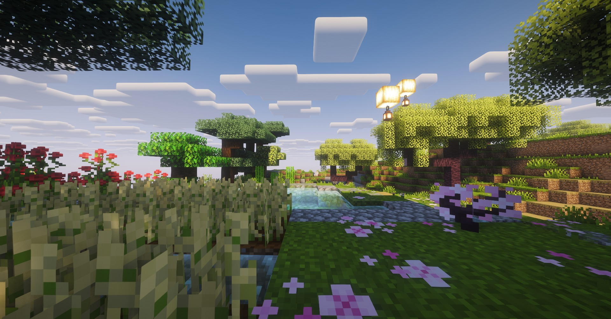
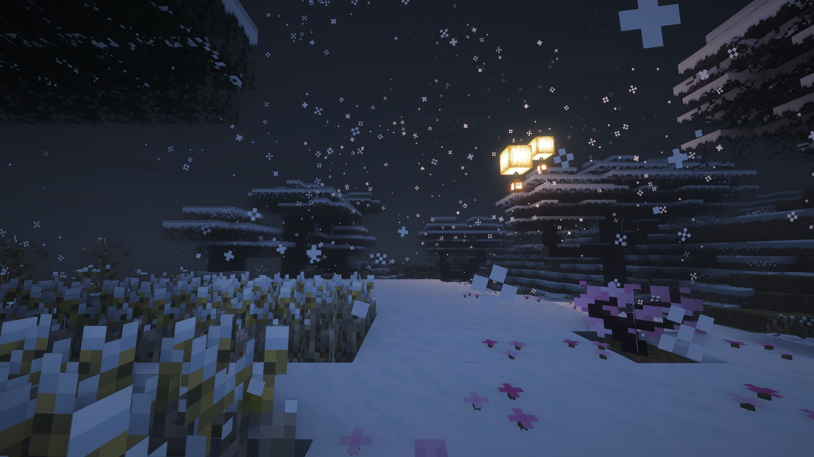
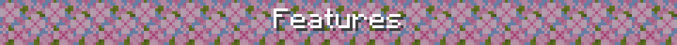
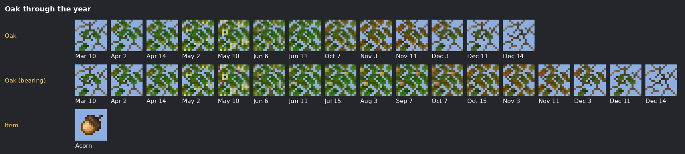
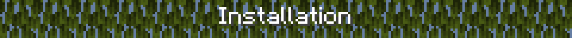
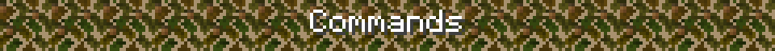
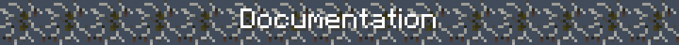

<p align="center"></p>

<h1 align="center">Equinox</h1>

<p align="center">
  
  
  <a href="LICENSE"></a>
  <a href="https://github.com/VenatorVictor/Equinox/wiki"></a>
</p>

<p align="center">The whole world follows the year: <b>Spring</b>, <b>Summer</b>, <b>Autumn</b> and <b>Winter</b>.</p>

| Spring | Summer |
|:---:|:---:|
|  |  |
| **Autumn** | **Winter** |
|  |  |

Equinox is a seasons mod for Minecraft (NeoForge 1.21.1). The year turns as it does on Earth: the seasons begin on
the equinoxes and solstices, summer days are long and winter days short, and a calendar keeps track of it all. Every
biome has its own climate in °C, snow falls and melts with the weather, crops grow by temperature, and trees bloom,
bear fruit and drop their leaves. The world can even follow your real clock and date.

No library mods are needed.



### Seasons
- Four seasons that begin on the equinoxes and solstices. A new world starts on the spring equinox.
- A season lasts 48 days by default (a 192-day year), or 24, 72 or 96 days in the settings.
- As on Earth, the seasons are slightly uneven: spring and summer run a little longer. With 48-day seasons they
  start on March 10, June 11, September 12 and December 11.
- Summer days are long and winter days short, depending on the latitude setting. A negative latitude puts the world
  in the southern hemisphere, where spring starts in September.
- No two years are the same: seasons and days come out randomly warmer or colder.
- The day, the season and the colors change at midnight; the year changes on January 1.

### Calendar
- 12 months of equal length, divided into weeks of 2 to 8 days.
- As in real life, the moon's cycle is a little shorter than a month, so the full moon falls on a different day each
  month. The phase changes at noon, never while the moon is in the sky.
- The calendar item can hang on a wall, where its season strip and month dots follow the date, or be opened to read
  its pages.
- The month page shows the days by week, with today framed, past days crossed out, and the new and full moons,
  equinoxes and solstices marked. Click a day to see its moon phase, day length and the next equinox or solstice.
- A moon page lists the 8 phases and their days, and an events page lists the year's equinoxes and solstices.
- Held in your hand, it shows the month, season, year and day in the top-left corner.

### Real time
- Off by default. When on, the world follows the real clock and date: a day lasts 24 hours, the seasons start on the
  real equinoxes and solstices, the moon matches the real one, and the calendar shows real months with
  Monday-to-Sunday weeks.
- Beds only set your spawn point, and `/time set` and `/season set` are disabled. A time zone setting picks the clock.

### Climate
- Every biome has its own temperature through the year, in °C: mild coasts, a cold north, deserts, rainy and dry
  tropics. The Nether and the End have their own.
- Neighboring biomes blend into each other, and winter fades out toward jungles and deserts.
- Geothermal patches (hot ground and steaming pools) stay above freezing all winter.
- Other mods can read the air and water temperature through the API.

### Snow
- Snow builds up while it snows and melts in the rain.
- It settles in grass, flowers and plants, on fences, gates and walls, in a thin layer on stairs and slabs, and on
  crops and leaves, with an animation as it appears and melts.
- Lakes and rivers freeze over while it snows.
- The snow cover is worked out a little at a time, so it doesn't slow the game down.

### Crops
- Crops grow by temperature: fast at their ideal temperature, slower when it's too cool or too warm, dormant in the
  cold, and killed by frost or heat.
- Campfires, torches and other heat sources protect them from frost; ice cools them down.
- On hot days, farmland needs water closer by.

### Trees and plants
- Grass and leaves change color through the year; birches turn yellow and orange in autumn.
- Flowers bud, bloom and go to seed.
- In autumn, trees drop their leaves one by one and stand bare through the winter. Cherries blossom on their bare
  twigs in spring, and flowering azaleas open in May.
- **Oak:** catkins in late spring. About a third of the leaf blocks also get tiny red flowers that grow into acorns
  over the summer. Right-click to pick the ripe acorns in mid autumn (they grow back the next year), and plant them
  for an oak sapling.
- **Birch:** small dark catkins on the bare twigs all winter, opening yellow when the leaves come out. About a third
  of the leaf blocks hang seed catkins, green in summer and brown in autumn: pick them for birch seeds.
- **Spruce:** stays green. Red pollen cones open at the end of late spring, and about a third of the leaf blocks
  grow seed cones, red in spring, green in summer and brown in early autumn: pick them for spruce cones. Old cones
  hang on through the winter.
- Snow covers the leaves too, on top of whatever they show.



### More
- Far terrain in Distant Horizons follows the colors and the snow.
- A settings screen with tabs, a description for every option and its performance cost.



1. Install [NeoForge](https://neoforged.net/) for Minecraft 1.21.1.
2. Put the Equinox jar in the `mods` folder of the server and of every player.

Don't use Equinox together with another seasons mod.



| Command | Who | What it does |
|---|---|---|
| `/season` or `/season get` | everyone | Shows the season, the climate and the temperature where you stand |
| `/season set <season> [week]` | operators | Jumps to a season (or one of its weeks) without changing the time of day |
| `/season add <days>` | operators | Moves the year forward (or back) by a number of days |



The [wiki](https://github.com/VenatorVictor/Equinox/wiki) covers the seasons, the calendar, the climate, the
settings, datapacks and the API in detail.

## Building

```sh
./gradlew build
```

Needs Java 21. The jar ends up in `build/libs/`.

## License

Copyright (C) 2026 VenatorVictor

Equinox is free software under the [GNU General Public License v3.0](LICENSE): you can share and change it, but
anything you share that is built on it must also be open source under the same license.
